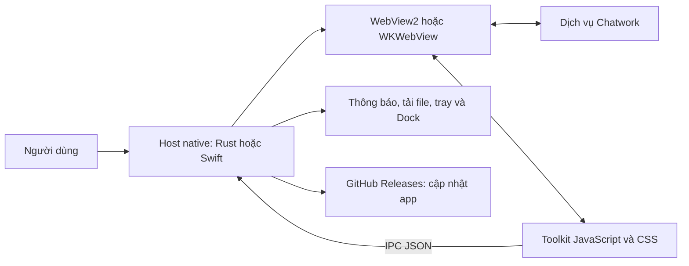

# THK-Chat Desktop

Ứng dụng desktop cho Chatwork, kết hợp giao diện web Chatwork với các tiện ích làm việc của THK: tổ chức danh mục theo cây, định dạng nội dung, tạo mẫu nghỉ phép/Pull Request và quản lý tệp đính kèm.

Windows sử dụng **Rust + WebView2**; macOS sử dụng **Swift + AppKit + WKWebView**. Ứng dụng dùng WebView của hệ thống, không đóng gói Electron hoặc Node.js để chạy.

**Phiên bản trong mã nguồn: 2.26.7** · [Tải ứng dụng](https://github.com/mrbinh008/chatwork-rust/releases/latest) · [Lịch sử phát hành](https://github.com/mrbinh008/chatwork-rust/releases)

## Mục lục

- [Giới thiệu hệ thống](#giới-thiệu-hệ-thống)
- [Cài đặt và bắt đầu](#cài-đặt-và-bắt-đầu)
- [Chức năng và cách sử dụng](#chức-năng-và-cách-sử-dụng)
- [Phím tắt](#phím-tắt)
- [App hoạt động như thế nào](#app-hoạt-động-như-thế-nào)
- [Dữ liệu và thiết lập](#dữ-liệu-và-thiết-lập)
- [Build, kiểm thử và phát hành](#build-kiểm-thử-và-phát-hành)
- [Giới hạn và xử lý sự cố](#giới-hạn-và-xử-lý-sự-cố)

## Giới thiệu hệ thống

THK-Chat gồm hai phần:

1. **Host desktop native** quản lý cửa sổ, menu, khay hệ thống/menu bar, thông báo, tải file và cập nhật ứng dụng.
2. **Giao diện Chatwork và Toolkit** chạy trong WebView. Chatwork cung cấp đăng nhập, phòng chat, tin nhắn, liên lạc và phân quyền; Toolkit bổ sung công cụ trên chính giao diện đó.

Đây là client riêng của THK, sử dụng dịch vụ Chatwork. App cần kết nối mạng và tài khoản Chatwork; dữ liệu trò chuyện được xử lý theo quyền truy cập của tài khoản đang đăng nhập.

| Thành phần | Windows | macOS |
|---|---|---|
| Host ứng dụng | Rust, `tao`, `wry` | Swift, AppKit |
| Bộ máy hiển thị | Microsoft Edge WebView2 | WKWebView/WebKit |
| Truy cập nhanh | System tray | Menu bar và Dock |
| Thông báo | Windows Toast | UserNotifications |
| Gói phát hành | Setup EXE, ZIP portable | DMG, ZIP, TAR.GZ Universal |
| Tiện ích giao diện | JavaScript/CSS dùng chung | JavaScript/CSS dùng chung |

## Cài đặt và bắt đầu

### Windows

Yêu cầu Windows 10/11 và WebView2 Runtime.

1. Mở [GitHub Releases](https://github.com/mrbinh008/chatwork-rust/releases/latest).
2. Chọn một trong hai gói:
   - `THK-ChatSetup-v<version>.exe`: cài theo hướng dẫn. Thư mục mặc định là `%LOCALAPPDATA%\THK-Chat`.
   - `THK-Chat-v<version>-Windows-x64.zip`: giải nén toàn bộ vào thư mục có quyền ghi và chạy `THK-Chat.exe`.
3. Với bản portable, giữ `WebView2Loader.dll` và thư mục `assets` cạnh file EXE.
4. Đăng nhập Chatwork trong cửa sổ ứng dụng.

### macOS

Yêu cầu **macOS 12 trở lên**. Gói Universal hỗ trợ cả Apple Silicon và Intel.

1. Tải DMG hoặc ZIP macOS Universal từ trang Releases.
2. Đưa `THK-Chat.app` vào **Applications**, rồi mở app từ đó.
3. Đăng nhập Chatwork và cho phép thông báo nếu muốn nhận thông báo desktop.

Bản Mac hiện ký **ad-hoc**, chưa có Developer ID/notarization. macOS có thể yêu cầu xác nhận trong Privacy & Security. Việc chuyển từ host Rust Mac cũ sang Swift có thể cần đăng nhập lại.

### Bắt đầu sử dụng

Sau khi chọn một phòng chat:

- Dùng các icon trên thanh soạn tin để chèn Info, Tiêu đề, Code, đường kẻ hoặc xem trước.
- Mở **⚙ Cài đặt** để chọn ngôn ngữ, bật/tắt nút và đặt phím tắt.
- Mở **Mở menu danh mục** bên trái, dùng `+` và `↳` để tổ chức thư mục.
- Mở **Quản lý file** để tìm và xem tệp của phòng hiện tại.

Đóng cửa sổ chính sẽ ẩn app để tiếp tục chạy. Để thoát hẳn, chọn **Quit/Thoát** trong menu ứng dụng hoặc tray/menu bar. Mở app lần nữa sẽ kích hoạt phiên đang chạy.

## Chức năng và cách sử dụng

### 1. Danh mục phòng theo cây thư mục

Cây được hiển thị ngay trên **các danh mục có sẵn của Chatwork**, trong vùng danh sách phòng bên trái. Các menu sửa/xóa, nút gập/mở và thao tác chọn phòng của Chatwork được giữ lại. Danh mục và phòng giữ thứ tự dữ liệu server trong từng cấp, thư mục con nằm trước các phòng của cha; phòng đã có trong nhánh con được ẩn ở cha.

| Thao tác trong menu danh mục | Chức năng |
|---|---|
| `+` | Tạo danh mục con và chọn các phòng đưa vào |
| `↳` | Chọn hoặc thay đổi thư mục cha |

**Tạo thư mục con:**

1. Tạo danh mục bằng menu có sẵn của Chatwork nếu chưa có danh mục cha.
2. Mở menu danh mục cha, bấm `+`, nhập tên và kiểm tra ô **Thư mục cha**.
3. Chọn phòng/nhóm/người dùng muốn đưa vào danh mục, rồi bấm **Lưu**.

Danh sách chọn đọc toàn bộ phòng và liên lạc có sẵn trong kho dữ liệu của phiên Chatwork, thay vì chỉ lấy các dòng đang thấy trên màn hình. Tên chat cá nhân được lấy từ người liên lạc tương ứng.

Bạn có thể lọc **Tất cả / Nhóm / Người dùng / Chat của tôi**, tìm tên có hoặc không dấu, chọn các mục đang lọc và bấm **Tải lại**. Các mục đã chọn được giữ khi tìm kiếm hoặc tải lại. Liên lạc chưa có phòng chat được ghi rõ và chưa thể chọn; hãy mở cuộc trò chuyện trước khi thêm vào danh mục.

**Đổi nhánh:** mở menu danh mục, bấm `↳`, chọn thư mục cha khác hoặc **Thư mục gốc**, rồi lưu. Có thể tạo nhiều cấp; ứng dụng kiểm tra để tránh chọn chính thư mục đó hoặc một thư mục con của nó làm cha.

Chatwork lưu danh mục và danh sách phòng. **Quan hệ cha–con do Toolkit lưu trên thiết bị**, riêng theo tài khoản. Vì vậy, tên danh mục và phòng có thể đồng bộ qua Chatwork, còn cấu trúc cây được chuyển giữa các thiết bị bằng file JSON trong **Cài đặt → Đồng bộ cây thư mục**. Bấm **Export cây thư mục**, chuyển file sang thiết bị khác cùng tài khoản, bấm **Import cây thư mục**, kiểm tra số thay đổi rồi bấm **Áp dụng cây thư mục**. Các danh mục ngoài file vẫn được giữ; danh mục chưa có được báo bỏ qua.

### 2. Định dạng tin nhắn và mô tả nhóm

Các icon **Info, Tiêu đề, Code, Đường kẻ, Xem trước** nằm trên thanh soạn tin. Chọn một đoạn văn bản trước khi bấm để bọc đoạn đó bằng thẻ Chatwork, hoặc đặt con trỏ để chèn mẫu trống.

Khi mở popup **Chỉnh sửa mô tả**, cùng bộ icon xuất hiện **bên trong popup, trên ô nhập**. Thao tác định dạng áp dụng vào ô mô tả, giữ nguyên bản nháp chat bên dưới. Bấm nút lưu của Chatwork để cập nhật mô tả nhóm.

Xem trước mô phỏng các thẻ Chatwork như Info, Title, Code, Quote, HR và TO. Markdown như `**bold**` được giữ dạng chữ theo bộ dựng hiện tại. Nút sao chép trên khối code giúp lấy nội dung mã mà không kèm nút giao diện.

### 3. Mention thành viên

Gõ `@` và một phần tên trong ô chat để mở danh sách gợi ý. Có thể tìm có/không dấu và tên nhiều từ; dùng `↑`/`↓`, rồi **Enter** hoặc **Tab** để chọn. Danh sách có lựa chọn `@ALL` và đánh dấu người đã được tag trong nội dung.

Nguồn thành viên gồm thành viên phòng và thành viên từ các team liên quan mà Chatwork cung cấp. Emoji sử dụng giao diện có sẵn của Chatwork.

### 4. Mẫu nghỉ phép / báo bận

Bấm nút lịch để chọn loại yêu cầu, ngày nghỉ, giờ bắt đầu/kết thúc, lý do và các leader cần tag. Mỗi ngày có khoảng giờ riêng; có thể thêm từng ngày hoặc thêm cả khoảng ngày cùng giờ. Form hỗ trợ xem trước, sao chép, chèn vào ô chat và gửi.

Ví dụ nội dung được tạo:

```text
[info]
- Request: PAID_LEAVE
- Time: 08:00 - 17:00  20/11/2026
- Reason: Personal matter
[/info]
```

Theo mặc định, nút xuất hiện trong phòng có tên chứa `Attendance infor_THKHN`. Có thể thay đổi việc hiển thị trong Cài đặt.

### 5. Mẫu Pull Request

Nút PR chèn mẫu trực tiếp vào ô chat:

```text
[toall]
[info]
Project name:
Pull Request:
Spec:
Thời gian review dự kiến:
[/info]
```

Tên dự án được ghi nhớ khi bạn sửa trong mẫu; lần chèn sau con trỏ chuyển đến trường còn cần nhập. Theo mặc định, nút xuất hiện trong phòng có tên chứa `【HN】Source Code Review`; có thể bật ở phòng khác qua Cài đặt.

### 6. Quản lý và xem trước file

Mở **Quản lý file** từ thanh soạn tin, lọc **Tất cả / Ảnh / Tài liệu / Video / Khác**, rồi tìm theo tên file hoặc người tải lên. Bấm tên file/nút **Xem trước** để mở nội dung, hoặc **Tải xuống** để chọn nơi lưu bằng hộp thoại hệ điều hành.

| Loại tệp | Cách hiển thị bản xem trước |
|---|---|
| Ảnh, PDF, video | Xem trong app, tùy định dạng được WebView hỗ trợ |
| Văn bản, mã nguồn, CSV, JSON… | Hiển thị nội dung văn bản |
| DOCX | Trích nội dung văn bản |
| PPTX | Nội dung văn bản theo slide, tối đa 50 slide |
| XLSX | Chọn sheet; tối đa 200 dòng × 50 cột mỗi sheet |

Giới hạn tải bản xem trước văn bản là **2 MiB**, DOCX/XLSX/PPTX **25 MiB**, PDF **64 MiB**. Ảnh/video có thể được mở từ URL trực tiếp; khi tải tạm vào bộ nhớ để xem, giới hạn là **64 MiB**. Bản xem trước Office là bản đọc nội dung cơ bản; bố cục có thể khác file gốc.

Danh sách file sử dụng phản hồi Chatwork hiện có. Khi không đọc được API, app có thể lấy các tệp đính kèm từ phần tin nhắn đã tải và ghi rõ nguồn dữ liệu. Đây không phải công cụ xuất toàn bộ lịch sử file của tài khoản.

### 7. Cài đặt, thông báo và điều khiển cửa sổ

- **Cài đặt Toolkit:** ngôn ngữ Auto/Tiếng Việt/English/日本語, bật/tắt nút và gán lại phím tắt.
- **Phạm vi hiển thị nút:** nhóm hiện tại hoặc tất cả nhóm. Thiết lập riêng của nhóm được ưu tiên; nút dùng thiết lập chung xóa phần ghi đè của nhóm đó.
- **Thông báo desktop:** tích hợp thông báo hệ điều hành, hỗ trợ ảnh người gửi khi có dữ liệu phù hợp. Bấm thông báo để mở lại cửa sổ và đi đến phòng/tin nhắn tương ứng khi có thông tin điều hướng.
- **Unread badge:** hiển thị số chưa đọc qua tiêu đề/tray trên Windows và Dock trên Mac.
- **Cửa sổ:** menu tải lại trang, quay lại/tiến tới và zoom. Bản Mac có menu bar, phím Command và thao tác toàn màn hình native.
- **Giao diện:** Toolkit lấy màu và font từ Chatwork, có hỗ trợ sáng/tối và nội dung popup cuộn trên cửa sổ nhỏ.

Để cấu hình thanh công cụ, mở **⚙**, chọn phạm vi rồi bật/tắt từng nút. Để đổi phím tắt, bấm ô tổ hợp phím hiện tại và nhấn tổ hợp mới; `Esc` hủy ghi nhận. `Backspace`/`Delete` xóa phần gán riêng để trở về tổ hợp mặc định.

### 8. Cập nhật ứng dụng

App kiểm tra bản stable trên GitHub Releases lúc khởi động và theo chu kỳ khoảng 6 giờ. Có thể kiểm tra thủ công tại:

- Windows: **Help → Check for Updates**.
- macOS: **THK-Chat → Check for Updates** hoặc menu bar.
- Cả hai: nút kiểm tra cập nhật trong Cài đặt Toolkit.

Khi có bản mới, chọn **Tải bản cập nhật**, sau đó **Cập nhật và khởi động lại**. Lưu nội dung đang soạn trước khi khởi động lại.

Updater kiểm tra phiên bản, kích thước, SHA-256 và cấu trúc gói; giữ bản trước để khôi phục khi thay thế thất bại. Hãy chạy bản Windows đã đóng gói hoặc `.app` Mac trong thư mục có quyền ghi, thay vì chạy trực tiếp trong DMG.

## Phím tắt

Đây là các tổ hợp mặc định của Toolkit; có thể đổi trong **⚙ Cài đặt**.

| Chức năng | Mặc định |
|---|---|
| Info | `Ctrl+I` |
| Info có tiêu đề | `Ctrl+Shift+I` |
| Code | `Ctrl+K` |
| Đường kẻ | `Ctrl+H` |
| Nghỉ phép / báo bận | `Ctrl+Shift+L` |
| Xem trước | `Ctrl+Shift+P` |
| Mẫu Pull Request | `Ctrl+Shift+R` |
| Quản lý file | `Ctrl+Shift+F` |

Toolkit nhận tổ hợp tương ứng bằng **Command** trên macOS. Một số phím có thể trùng lệnh của hệ điều hành hoặc menu ứng dụng, chẳng hạn `Cmd+H` để ẩn app. Khi gặp xung đột, dùng icon hoặc gán tổ hợp khác trong Cài đặt.

## App hoạt động như thế nào



1. **Khởi động:** host nạp cấu hình, kiểm tra phiên đang chạy và tạo cửa sổ/WebView.
2. **Đăng nhập:** WebView tải Chatwork. Cookie và phiên đăng nhập được lưu trong kho dữ liệu của WebView.
3. **Nạp Toolkit:** host đưa các script và CSS đi kèm bản build vào trang. Toolkit thêm công cụ soạn thảo, popup, danh mục và quản lý file.
4. **Đọc dữ liệu:** Toolkit dùng kho phòng/người dùng và các chức năng sẵn có trong phiên Chatwork. Các yêu cầu danh mục sử dụng dịch vụ native của trang, cùng phiên đăng nhập và quyền hiện tại.
5. **Tương tác hệ điều hành:** JavaScript gửi thông điệp JSON qua IPC để host xử lý thông báo, badge hoặc cập nhật. Tải file được kết nối với WebView và hộp thoại lưu native.
6. **Theo dõi giao diện:** các observer và kiểm tra định kỳ gắn lại công cụ khi Chatwork dựng lại DOM hoặc đổi phòng.

App không có backend Chatwork riêng. Dịch vụ Chatwork tiếp tục quản lý tin nhắn, tài khoản, nhóm và phân quyền; GitHub Releases cung cấp gói cập nhật desktop.

## Dữ liệu và thiết lập

| Dữ liệu | Nơi lưu |
|---|---|
| Phòng, tin nhắn, liên lạc, tên danh mục, phòng trong danh mục | Dịch vụ Chatwork |
| Quan hệ thư mục cha/con | `localStorage` của WebView, riêng theo tài khoản |
| Ngôn ngữ Toolkit, nút hiển thị, phím tắt, tên dự án PR… | `localStorage` của WebView |
| Phiên đăng nhập | Kho cookie/website data của WebView |
| Cấu hình host Windows | `%APPDATA%\Chatwork\config.json` |
| Website data Windows mặc định | `%APPDATA%\Chatwork\WebView2Data` |
| Cấu hình host Mac | UserDefaults; vị trí cửa sổ do AppKit lưu |
| Website data Mac | Kho bền vững mặc định của WebKit |

Thiết lập local phụ thuộc hồ sơ WebView và thiết bị. Xóa website data có thể làm mất phiên đăng nhập và thiết lập Toolkit trên máy; cài app trên thiết bị mới cần thiết lập lại cấu trúc cây.

## Build, kiểm thử và phát hành

### Build Windows

Cần Rust, MSVC/Windows SDK, WebView2 Runtime và PowerShell. Cài NSIS nếu cần tạo Setup EXE. Node.js chỉ cần cho các bài kiểm thử JavaScript; app đã đóng gói không cần Node.js.

```powershell
git clone https://github.com/mrbinh008/chatwork-rust.git
cd chatwork-rust
./build.ps1 -Online
```

Script chạy kiểm thử Rust, build release và đóng gói vào `dist/`. `-Online` cho phép tải dependency; bỏ tùy chọn này khi dependency đã có trong cache. Nếu thiếu NSIS, script vẫn tạo ZIP portable.

### Build macOS Swift

Cần Mac với Xcode/Command Line Tools, Swift compiler và macOS SDK.

```bash
bash build-mac.sh --native       # Kiến trúc của máy đang build
bash build-mac.sh --universal    # Apple Silicon và Intel
```

Script kiểm thử/type-check Swift, build tối ưu, đóng gói và ký ad-hoc. Kết quả trong `dist/` gồm app bundle và các gói archive; DMG được tạo khi có `hdiutil`.

Đường build Docker trên Windows qua `build-mac-docker.ps1` dành cho **host Rust Mac cũ**. Bản Swift/AppKit được build trên Mac hoặc runner macOS của GitHub Actions.

### Chạy kiểm thử

Kiểm thử JavaScript dùng các module có sẵn của Node.js:

```powershell
$checks = @(
    'toolkit', 'room-directory', 'native-folders', 'folder-layout',
    'description-toolbar', 'formatting-editors', 'mention', 'ui-render',
    'files', 'downloads', 'file-preview', 'branding', 'request-navigation'
)
foreach ($check in $checks) {
    node "examples/$check-regression.cjs"
    if ($LASTEXITCODE -ne 0) { throw "Failed: $check" }
}
```

Kiểm thử host Rust Windows: `cargo test --locked` hoặc chạy `build.ps1` để kiểm thử cùng quá trình build/đóng gói. Script build có xử lý linker cho toolchain Windows GNU.

Trên Mac:

```bash
bash mac/test-native.sh
node examples/mac-bundle-regression.cjs dist/THK-Chat-v2.26.7-macOS-Universal/THK-Chat.app
```

Bài kiểm tra bundle cần chạy sau khi đã build Universal; đối chiếu phiên bản, hai kiến trúc, toàn bộ script/CSS, updater và icon trong gói với mã nguồn.

### GitHub Actions và release

| Workflow | Khi chạy | Kết quả |
|---|---|---|
| [build-mac.yml](.github/workflows/build-mac.yml) | Push `main`/`master`, pull request hoặc chạy thủ công | Kiểm thử và artifact macOS Swift Universal |
| [release.yml](.github/workflows/release.yml) | Push tag `v*` hoặc chạy thủ công | Build Windows và Mac; chỉ publish khi là tag và cả hai job đạt |

Để phát hành phiên bản mới:

1. Đồng bộ phiên bản trong `Cargo.toml`, `Cargo.lock`, `mac/Info.plist`, giá trị mặc định của `installer.nsi` và phần giới thiệu README.
2. Chạy kiểm thử, commit và push code.
3. Tạo/push tag khớp phiên bản, ví dụ `v2.26.7`.
4. Kiểm tra Actions và các asset trên trang Releases.

Updater sử dụng gói `THK-Chat-v<version>-Windows-x64.zip` hoặc `THK-Chat-v<version>-macOS-Universal.tar.gz`. Các file SHA256 được phát hành cùng bộ cài và archive.

### Cấu trúc mã nguồn

| Đường dẫn | Vai trò |
|---|---|
| `src/main.rs`, `src/app.rs`, `src/config.rs` | Khởi động và cấu hình host Rust |
| `src/menu.rs`, `src/tray.rs`, `src/notification.rs`, `src/taskbar.rs` | Menu, tray, thông báo và badge Windows |
| `src/injected.js`, `src/ui.css` | Định dạng, mention, form nghỉ, preview và giao diện Toolkit |
| `src/toolkit.js` | Cài đặt, phím tắt, PR và danh sách phòng/liên lạc |
| `src/room-folders.js` | Phân cấp danh mục, giữ thứ tự server trong mỗi cấp |
| `src/files.js`, `src/file-preview.js`, `src/downloads.js` | Quản lý, xem trước và điều phối tải file |
| `src/updater.rs`, `src/update-ui.js`, `ota/` | Cập nhật và giao diện cập nhật |
| `mac/Native/` | Host Swift, chính sách điều hướng và updater Mac |
| `examples/`, `mac/Tests/` | Các bài kiểm thử |
| `build.ps1`, `mac/build-universal.sh`, `.github/workflows/` | Build, đóng gói và phát hành |

## Giới hạn và xử lý sự cố

- **Không thấy công cụ hoặc bố cục thay đổi:** thử tải lại từ menu View và kiểm tra bản cập nhật. Các tiện ích tích hợp với DOM/dịch vụ nội bộ của trang nên có thể cần điều chỉnh khi Chatwork đổi giao diện.
- **Danh sách chọn thiếu tên hoặc chưa cập nhật:** kiểm tra bộ lọc/từ khóa, bấm Tải lại và chờ cập nhật thông tin liên lạc. Dữ liệu phụ thuộc phiên đăng nhập và quyền truy cập Chatwork.
- **Thư mục trên máy khác có cấu trúc khác:** thiết lập lại quan hệ cha/con trên thiết bị đó; các thiết lập này lưu local.
- **Không nhận thông báo:** kiểm tra quyền thông báo của hệ điều hành và thiết lập thông báo của Chatwork. Ảnh người gửi và điều hướng đến tin nhắn phụ thuộc dữ liệu thông báo nhận được.
- **Không xem được file:** dùng Tải xuống để mở bằng ứng dụng phù hợp. Quyền truy cập, giới hạn dung lượng và codec của WebView ảnh hưởng khả năng xem trước.
- **Không cập nhật được:** kiểm tra kết nối GitHub, quyền ghi thư mục ứng dụng và việc app đang chạy từ gói cài đặt hợp lệ. Bản Mac nên nằm trong Applications.
- **SSO/đăng nhập:** tuân theo quy trình Chatwork và chính sách tổ chức; khả năng đăng nhập trong WebView còn phụ thuộc nhà cung cấp xác thực.

Các bài kiểm thử tự động xác minh logic và đóng gói; chúng không thay thế toàn bộ thao tác đăng nhập/SSO và kiểm tra giao diện trên từng máy. Dự án chưa có benchmark CPU/RAM/khởi động chuẩn hóa để công bố so sánh hiệu năng.
